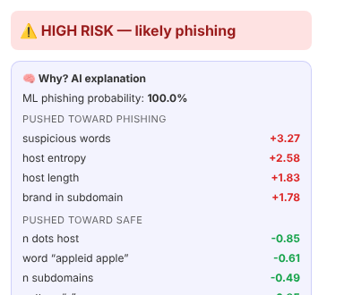

# Phishing Hunter — AI-Powered Phishing Detection


A Chrome extension and Flask API that detect phishing websites and emails in real time. The
system combines a **multi-layer detection engine** with **explainable machine learning**:
URL classification, page-content analysis, behavioural monitoring and a DistilBERT email
classifier.

---

## What's new in v2: explainable AI and a stronger URL model

| | v1 | **v2** |
|---|---|---|
| Model | Random forest on char 3-4 grams | **Logistic regression on 450k features**: char 1-5 grams, word 1-2 grams, 25 lexical features |
| Accuracy (held-out) | 89.4%* | **98.56%** |
| F1 (phishing class) | 0.724* | **0.968** |
| ROC-AUC | 0.930* | **0.9975** |
| Real-world sanity checks | google.com flagged at 52%; github.com/login at 84% | **16 / 16 correct** |
| Explanations | none | **Exact per-feature contributions** via `/explain_url` and in the popup |
| Model size | 7.7 MB | 7.9 MB |

\* The v1 model was measured on the same v2 test URLs. Its training split may have overlapped
those URLs, so the true v1 numbers are likely *lower* than shown.

### What changed and why

1. **The scheme bug is fixed.** The training URLs have no `https://`, but the browser sends
   full URLs. v1 therefore saw characters at prediction time that it never trained on, and
   flagged sites like google.com. v2 normalises every URL the same way for training and for
   prediction.
2. **De-duplication before splitting.** 42k duplicate URLs were removed *before* the
   train/test split, so no test URL also appears in training and the scores are honest.
3. **Richer features.** Three views of each URL are stacked together:
   - character n-grams catch obfuscation such as `paypa1` and `-secure-`;
   - word n-grams catch brand plus action words such as `appleid apple` and `verify account`;
   - 25 lexical features: IP host, risky TLD, host entropy, brand in subdomain, punycode,
     URL shorteners, a learned reputable-domain signal, and more.
4. **Dataset-bias fix.** The Kaggle "good" URLs are mostly content pages, which made normal
   login and inbox pages look phishy. 559 curated legitimate app pages were added to the
   **training split only**. The sanity-check URLs use different paths, so they test
   generalisation rather than memorisation.
5. **Explainable by construction.** For a linear model the log-odds are exactly
   Σ weightᵢ·valueᵢ + bias, so each feature's contribution is exact rather than an
   approximation.

<p align="center"></p>

```bash
curl "http://localhost:5000/explain_url?url=http://appleid.apple.com.verify-session.xyz/signin"
```

```json
{
  "prediction": "phishing", "phishing_probability": 1.0,
  "toward_phishing":  [{"feature": "lex:suspicious_words", "contribution": 3.27},
                       {"feature": "lex:host_entropy", "contribution": 2.59},
                       {"feature": "lex:brand_in_subdomain", "contribution": 1.78}],
  "toward_legitimate": [{"feature": "lex:n_dots_host", "contribution": -0.85}]
}
```

---

## Features

### 🛡️ Website protection
- **6-layer detection engine**: basic validation and allowlist → feature analysis
  (WHOIS, SSL, domain) → content analysis → ML classification → ensemble decision → final
  verdict
- **Real-time notifications** while browsing, plus a manual scan from the popup
- **Content and behaviour analysis**: HTML source patterns, suspicious forms, redirects

### 📧 Email phishing detection
- **DistilBERT classifier** with 4 classes: Safe, Suspicious, Phishing, Malware
  (optional; see below)
- **Pattern engine** (always on): urgency, financial pressure, credential requests,
  suspicious links, sender-domain checks
- **Automatic compose detection** in Gmail, Outlook and Yahoo Mail

### 📊 User experience
- Modern popup UI with scan, email, history and settings tabs
- Detailed reports with recommendations
- A user-feedback loop for future retraining

---

## Architecture

```
┌──────────────┐   ┌────────────────┐   ┌────────────────────┐
│ Website /    │──►│ Content script │──►│ Background worker  │── notifications
│ Email page   │   │ (DOM, compose) │   │ (monitoring)       │
└──────────────┘   └────────────────┘   └─────────┬──────────┘
                                                  │ REST
┌──────────────┐                        ┌─────────▼──────────┐
│ Popup UI     │◄──────────────────────►│ Flask API          │
│ + AI "Why?"  │   /check_url           │ api_server.py      │
└──────────────┘   /explain_url         └─────────┬──────────┘
                                                  │
              ┌───────────────────────────────────┼───────────────────────────┐
              ▼                                   ▼                           ▼
   LayeredPhishingDetector            URL model v2 (url_features.py)   DistilBERT email model
   (phishing_detector.py)             LogReg on 450k features          (optional, models/email)
```

---

## Installation

### 1. Backend

```bash
git clone https://github.com/<your-username>/PhishingHunter.git
cd PhishingHunter
python -m venv venv
# Windows: venv\Scripts\activate      macOS/Linux: source venv/bin/activate
pip install -r requirements.txt
python api_server.py
```

The API starts on `http://localhost:5000`. The URL model is included in the repo, so no
training is needed.

### 2. Chrome extension

1. Open `chrome://extensions/` and turn on **Developer mode**.
2. Click **Load unpacked** and select the `chrome_extension/` folder.
3. Pin **Enhanced Phishing Hunter** to the toolbar.

### 3. (Optional) DistilBERT email model

The fine-tuned email model (`model.safetensors`, 268 MB) is **not stored in this repository**,
because GitHub rejects files larger than 100 MB. Without it, email analysis automatically falls
back to the pattern engine. To enable it:

1. Get `model.safetensors` from the project's
   [Releases](https://github.com/<your-username>/PhishingHunter/releases) page, or from the
   original project archive.
2. Put it in `models/email/`. The tokenizer and config files are already there.
3. Install the extra dependencies: `pip install -r requirements-email.txt`

---

## Retraining the URL model

```bash
python training/train_url_model.py
```

This takes about 6 minutes on a laptop. It re-creates `models/phishing_classifier.pkl`,
`models/tfidf_vectorizer.pkl` and `models/evaluation_results.json`, which holds the metrics,
sanity checks and top indicators. The dataset is `training/phishing_site_urls.csv`
(549k labelled URLs). The original v1 script is kept as `training/train.py` for reference.

---

## API endpoints

| Method | Endpoint | Description |
|---|---|---|
| GET | `/check_url?url=<url>` | Quick multi-layer URL check |
| POST | `/analyze_detailed` | Comprehensive website analysis |
| POST | `/analyze_source` | HTML source analysis |
| GET/POST | `/explain_url` | **v2:** explain the ML verdict for a URL |
| GET | `/model_info` | **v2:** URL-model metrics and top indicators |
| POST | `/analyze_email` | Full email analysis (AI + patterns) |
| POST | `/check_email_quick` | Fast pattern-based email check |
| GET | `/health` | Server health |
| POST | `/feedback` | Submit user feedback |
| GET | `/learning_stats` | Feedback statistics |

---

## Testing

```bash
pip install pytest
pytest -v
```

The 19 tests cover URL normalisation, lexical features, legitimate and phishing URLs, the
scheme-invariance bug fix, exact explanations, and the API endpoints including the email
fallback. They run on every push via GitHub Actions.

---

## Project structure

```
PhishingHunter/
├── api_server.py              # Flask REST API
├── phishing_detector.py       # 6-layer detection engine
├── content_analyzer.py        # HTML/content analysis
├── url_features.py            # v2 URL featurizer + explanations
├── email_phishing_ml/         # email detector helpers
├── chrome_extension/          # Manifest V3 extension (popup, background, content script)
├── models/                    # URL model (v2) + email tokenizer/config
├── training/
│   ├── train_url_model.py     # v2 training pipeline
│   ├── train.py               # v1 pipeline (reference)
│   └── phishing_site_urls.csv # dataset (549k URLs)
├── tests/                     # pytest suite
└── docs/
```

---

## Troubleshooting

- **The extension can't connect:** start `python api_server.py` and check that
  `http://localhost:5000/health` responds.
- **"ML model not found":** run `python training/train_url_model.py`.
- **Email AI not used:** the DistilBERT weights are missing. See step 3 of Installation;
  the pattern engine still works without them.

## License

MIT. See [LICENSE](LICENSE).

---

**Note:** this project is for educational and security purposes. Always be careful with
suspicious websites and emails, and never give personal information to unverified sources.
